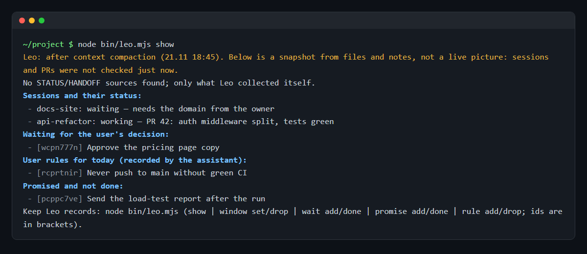

# Leo

**Leo keeps Claude Code on track: it restores your sessions, promises and rules after context compaction, and has a Haiku skeptic fact-check the final answer before you see it.**

MIT · Node.js 18+ · Windows, macOS, Linux · zero dependencies



## Install

Needs Claude Code and Node.js 18+.

```bash
claude plugin marketplace add zhichkin44-del/leo-claude-plugin
claude plugin install leo@leo-marketplace
```

On Claude Code 2.1.292+ one line is enough: `claude plugin install leo --marketplace zhichkin44-del/leo-claude-plugin`.

Start a new session, then run `/leo:doctor`. It checks Node, `claude` in PATH, the hooks, file rights and your config, and tells you what to fix.

## What it does

After the context is compacted, Claude forgets what was going on. Leo puts the important part back (at most 40 lines): your open tasks, your last request, standing instructions you gave ("always...", "never..."), files touched recently, and, if you keep them, sessions and their status, what waits for your decision, rules and promises.

**It works out of the box.** Before compaction (PreCompact) and again at session start Leo reads the session transcript and collects this itself: no setup, no manual notes, no model call. State is kept per `session_id`, so two windows never see each other's tasks.

Before a final answer reaches you, Leo asks Claude Haiku (one call, no tools, one turn) to read it in two roles:

- **reader**: is it in plain words, short, free of unexplained jargon, clear what you must do?
- **skeptic**: does it claim "done / merged / works" without proof? Was something promised and dropped? Are your rules broken?

A serious finding sends the answer back for one fix round (`mode: block`) or only whispers a hint (`mode: advice`). Everything else stays silent.

```
PreCompact --> hooks/precompact.mjs --> lib/collect.mjs --> state.json (per session_id)
PostCompact --> hooks/postcompact.mjs --> log entry
SessionStart (compact|resume) --> hooks/session-start.mjs --> lib/restore.mjs --> <= 40 lines into context
                                  sources: session transcript, state.json, optional STATUS.md / HANDOFF-*.md / memory index

Stop (final answer) --> hooks/stop.mjs --> lib/skeptic.mjs --> claude -p (Haiku, no tools, 1 turn, timeout)
                            |                                       |
                            |  secret filter (lib/secrets.mjs) <----+  verdict JSON
                            v
            serious finding -> decision: block + reason (or a hint in advice mode)
            suspected new standing rule -> additionalContext hint (Leo never writes memory itself)
            otherwise -> silence
```

Example of a block (the assistant sees this and fixes its answer):

```
Leo's check (Haiku in the roles "reader" and "skeptic") found serious problems in the answer:
1. [skeptic] Says "merged" but gives no commit id or test output.
Fix the answer accordingly. If a finding is wrong, say why in one sentence and answer the user.
```

## Why Leo

- **Light and transparent.** No database, no background process, no hook on every message, zero dependencies. Four hook events (none per message), a few files you can read in ten minutes.
- **It checks the answer, not only the memory.** Most compaction plugins save and restore state. Leo also fact-checks the final answer, with a loop guard (one Haiku call and one block round per answer, and the inner call cannot trigger Leo again).
- **Honest about secrets.** A filter masks values (not paths) before anything is written, restored or sent to Haiku. It is a safety net, not a guarantee.

| | Leo | claude-mem | context-recovery | token-optimizer |
|---|---|---|---|---|
| Dependencies | none | Node, SQLite, Chroma | Python stdlib | see its README |
| Database | none (one JSON file) | SQLite + Chroma | files | see its README |
| Checks the final answer | yes (Haiku skeptic) | no | no | no |
| Saves before compaction (PreCompact) | yes | yes | yes | yes |

Not for you if you want memory across projects and search over history: use claude-mem. Leo is about one long session staying honest and not losing the thread. The table reflects the projects' public descriptions on 2026-11-20; check their READMEs before relying on it.

## What leaves your machine

Leo has no server, no telemetry and makes no network calls of its own. The only thing that leaves your machine is the Haiku call, made through **your own installed `claude`, under your own account**:

- the final answer of the assistant, up to **8000 characters** (the middle is cut if longer);
- your **3 latest messages** from the session transcript;
- your rules for today and the open promises Leo stored.

Everything passes the secret filter first. Answers shorter than 120 characters are never sent; answers from 120 to 599 characters are sent only if they contain claim words such as "done", "fixed", "merged". Nothing is sent when Leo is off.

What Leo stores locally, in `~/.claude/leo/` (or `$LEO_HOME`): `state.json` (sessions, pending items, promises, rules; texts up to 300 characters, filtered), `leo.log` (verdict, number of findings, time, cost; never the text of answers), `config.json` (yours), and an `off` switch file. Files are created with mode 0600 on macOS and Linux; on Windows they inherit your profile's permissions. Turn the journal off with `"log": false` or `LEO_NO_LOG=1`.

`leo doctor` prints the same summary. Turn Leo off with `/leo:off`.

## Configuration

Create `~/.claude/leo/config.json`. Every key is optional; the schema is in [`docs/config.schema.json`](docs/config.schema.json) and `leo doctor` validates it.

| Key | Default | Meaning |
|---|---|---|
| `lang` | system locale, else `en` | `en` or `ru`: language of Leo's messages and of the Haiku prompt (`LEO_LANG` overrides) |
| `mode` | `advice` | `advice` only hints; `block` sends a serious finding back for a fix (`LEO_MODE`) |
| `minLength` | `600` | answers this long are checked even without claim words (`LEO_MIN_LENGTH`) |
| `triggers` | `[]` | extra claim words |
| `model` | `haiku` | model for the check (`LEO_MODEL`) |
| `maxCostPerDay` | `0` | dollars per day, `0` means no limit |
| `roles` | both `true` | switch `reader` or `skeptic` off |
| `ruleTtlDays` | `1` | how long a rule added with `rule add` stays active |
| `autoCollect` | `true` | collect tasks, last request, instructions and files from the transcript |
| `log` | `true` | write `leo.log` |
| `sources` | `{}` | optional `status`, `handoffDir`, `memoryIndex` files that Leo also reads |
| `profile` | `default` | `director`: the author's personal Russian vocabulary |

Environment: `LEO_HOME`, `LEO_OFF=1` (hooks stay silent), `LEO_NO_LOG=1`, `LEO_HAIKU_TIMEOUT_MS` (default 45000), `LEO_CLAUDE` (full path to `claude`).

## Commands

Inside Claude Code: `/leo:show` (what Leo would restore now), `/leo:status`, `/leo:doctor`, `/leo:off`, `/leo:on`.

From a terminal: `node "<plugin folder>/bin/leo.mjs" <command>`:

```
show | status | log [n] | doctor [--ping] | off | on
window set <name> <status> [note] | window drop <name>
wait add <text> | wait done <id>
promise add <text> | promise done <id>
rule add <text> | rule drop <id>
```

`log` prints the last verdicts, how many blocks, the total cost and the average time. `doctor --ping` makes one real, tiny Haiku call and reports time and cost.

## Troubleshooting

Run `/leo:doctor` first; each `[FIX ]` line says what to do.

- **"claude was not found in PATH"**: hooks sometimes run with a shorter PATH than your terminal (IDEs, desktop app). Put the folder with `claude` into PATH, or set `LEO_CLAUDE` to its full path. Without it the answer check silently does nothing.
- **"no --safe-mode flag"**: update Claude Code (`claude update`).
- **"Cannot write to ..."**: fix the permissions of `~/.claude/leo` or set `LEO_HOME` to a writable folder.
- **Little is restored after compaction**: Leo restores what the transcript shows (open `TodoWrite` tasks, your last request, "always/never" instructions, edited files) plus anything you recorded with the commands above. If a session had no todo list and no such instructions, there is little to restore. Check with `/leo:show`; `"autoCollect": false` turns the collection off.
- **Too slow**: the check adds about 8 to 11 seconds to a long final answer (measured on Windows with the direct `claude.exe`; about 22 s through `claude.cmd`). Use `"mode": "advice"`, raise `minLength`, or `"roles": {"reader": false}`.

## Limitations

- Needs the `claude` CLI signed in and online for the answer check.
- The check is probabilistic: Haiku can miss a finding or nitpick. A serious finding gives one block round, then the answer goes through.
- Automatic collection is heuristic: it sees open `TodoWrite` tasks, the last substantial user message, sentences with words like always/never/всегда/никогда, and the last edited files. It does not understand the conversation; use `rule add`, `wait add`, `promise add` for what matters most.
- The `PostCompact` hook only writes a journal entry; the restore itself comes from `SessionStart` with the `compact` matcher.
- Tests were developed on Windows; macOS and Linux are covered by the CI workflow in `.github/workflows/ci.yml` (3 systems x Node 18/20/22), which runs after the first push.
- The secret filter is a safety net: it knows common token formats and `KEY=value` lines, not every secret in the world.

## Contributing

`npm test` runs everything with a fake `claude` (`tests/fake-claude.mjs`), no network. To add a secret rule, add it to `lib/secrets.mjs` and a positive and a negative sample to `tests/secrets.test.mjs`. Messages live in `lib/i18n.mjs`; a test checks that English and Russian have the same keys.

## License

MIT
